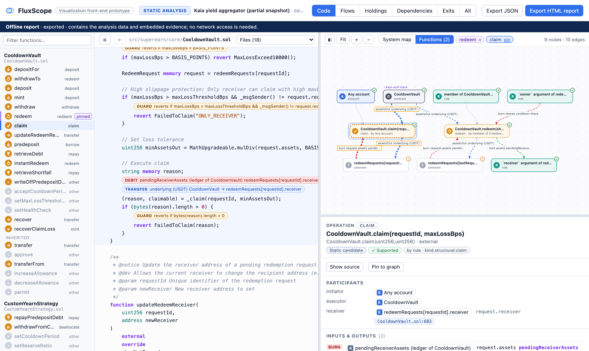

# FluxScope

FluxScope recovers how assets and positions move through a DeFi system (asset
flows, holdings, claims, dependencies and exit paths) from Solidity code, and
shows the result next to the source as an interactive, offline HTML report in
which every statement leads back to code evidence. It combines static analysis
(Slither), call-context summaries, standard and structural rules, a checker and
an optional language-model stage whose proposals must cite program facts. It is
aimed at smart-contract auditors and developers.

> **Research prototype** (ICSE 2027 Tool Demonstrations submission). Runs end to
> end on three real projects at pinned commits (Beefy Vault V7 +
> StrategyERC4626; a Kaia yield aggregator, partial snapshot; MetaMorpho as a
> held-out case) and on synthetic fixtures. See [Validation](#validation) and
> [Limitations](#limitations).



```
Solidity project ──► Slither facts ──► effect summaries (call context, role rebinding)
                                   ──► standard / structural rules ──┐
                                   ──► LLM proposals (optional) ─────┤──► checker ──► result.json ──► offline HTML
           chain state / traces (data model only, no importer yet) ──┘
```

## Try it — nothing to build

| | |
|---|---|
| **Website** | `https://pypy233.github.io/FluxScope/` — the reports of the real projects and the example gallery, served from `dist/` (GitHub Pages). Everything runs in the browser; nothing is sent anywhere. |
| **Offline** | Open `dist/index.html` (or any `dist/reports/*.html`) from a clone in a browser. |
| **Docker** | `docker run --rm -p 8765:8765 ghcr.io/pypy233/fluxscope` and open <http://localhost:8765>: the viewer with the *Analyze project* panel, which runs real analyses of the bundled projects (image for linux/amd64 and linux/arm64, ~0.9 GB; Slither, Foundry and the needed solc versions are inside, so analyses also run without network). One analysis to a file: `docker run --rm -v "$PWD/out:/out" ghcr.io/pypy233/fluxscope fluxscope analyze corpus/kaia-yield --html /out/kaia-yield.html`. Your own Foundry project (with a `fluxscope.json`, see [Analyse a project](#analyse-a-project)): `docker run --rm -v "$PWD:/work" ghcr.io/pypy233/fluxscope fluxscope analyze /work --html /work/fluxscope-report.html`. |
| **Video** | VIDEO_URL (3–5 min walkthrough) |

## Walkthrough

Reports open in the **Code** view.

1. **System map.** On the right, the analysed contracts, one node for all
   users and roles, and one edge per pair of parties listing the assets any
   function moves between them (Kaia yield aggregator: users ↔ CooldownVault ↔
   CustomYearnStrategy ↔ CustomVault ↔ CustomStrategy, plus the external Yearn
   vault). MetaMorpho's map shows Morpho Blue as an out-of-scope boundary.
2. **Open a function.** Pick one in the list on the left (e.g.
   `CooldownVault.redeem`). Its source opens and the graph shows only that
   function: who may call it, which assets it moves between whom, and the
   functions it calls (collapsed; `+` opens the next level). Above each
   statement a lens says what the analysis read from it — `TRANSFER`, `MINT`,
   `BURN`, `CREDIT`/`DEBIT` of a ledger, `WHO` (access control), `GUARD`, `IF`,
   `CALL` — and the function header gives the operation kind and caller (marked
   when the kind was proposed by the model).
3. **Code ↔ graph.** Hover a marked line: the graph items it supports light up.
   Hover a graph edge or node: its lines light up (or a link names the other
   file). Click either to select it; details, conditions, checks and evidence
   appear under the graph.
4. **Build the picture up.** *Pin* `redeem`, then open `claim`: the graph now
   shows the two-step withdrawal — shares burned and a pending claim recorded,
   later consumed when USDT is paid out.
5. **Whole system.** The tabs *Flows · Holdings · Dependencies · Exits · All*
   show the complete result; in *Holdings* select a share (e.g. Beefy's
   **mooToken**) to see who holds it, which positions back it, what it depends
   on and how to exit, with the checks behind each claim.

`dist/reports/*.llm.html` are the same reports with the recorded LLM proposals
merged (marked as model-proposed, with the checker's verdict).

## Install from source

```bash
python3 -m venv .venv
.venv/bin/pip install -e ".[server,llm,test]"
bash scripts/build_all.sh      # viewer, reports, replayed LLM evaluation, all tests
```

Requirements: Python ≥ 3.10 and [Foundry](https://getfoundry.sh) (`forge` on
`PATH` or in `~/.foundry/bin`; it fetches the pinned solc versions). The viewer
tests drive the local Chrome through Playwright.

## Analyse a project

A project directory needs a `fluxscope.json` next to its build configuration:

```jsonc
{
  "name": "Beefy Vault V7 + StrategyERC4626",
  "repository": "https://github.com/beefyfinance/beefy-contracts",
  "commit": "e33f868e2d995c2db9219029c26d31cd8e7d5cb2",
  "build": {"framework": "foundry"},
  "instances": [                                  // deployed contract instances to analyse
    {"id": "vault", "contract": "BeefyVaultV7", "group": "beefy"},
    {"id": "strategy", "contract": "StrategyERC4626", "group": "beefy"}
  ],
  "bindings": [                                   // deployment wiring: state variable -> instance
    {"instance": "vault", "variable": "strategy", "target": "strategy"},
    {"instance": "strategy", "variable": "vault", "target": "vault"}
  ],
  "registries": [],                               // optional: instances registered in an address set / mapping,
                                                  //   e.g. {"instance": "vault", "variable": "isStrategy", "members": ["strategy"]}
  "identities": [],                               // optional: expressions known to be the same token
  "assets": [{"expression": "strategy.want", "label": "want"}],   // display labels only
  "dependencies": [{"path": "lib/openzeppelin-contracts-upgradeable-4.9.6",
                    "package": "@openzeppelin/contracts-upgradeable", "version": "4.9.6"}]
}
```

```bash
python -m fluxscope analyze corpus/beefy-erc4626 --json out/beefy.json --html out/beefy.html
python -m fluxscope validate out/beefy.json
python -m fluxscope report out/beefy.json --out out/report.html
python -m fluxscope diff before.json after.json        # semantic diff after a code change
python -m fluxscope schema                               # regenerate schema/…schema.json
```

With an LLM (optional). Pick a provider with `--llm`:

| `--llm` | Credentials | How |
|---|---|---|
| `claude-cli` | Claude subscription (no API key) | Runs `claude -p` (Claude Code, headless) with tools disabled and the output constrained by `--json-schema`. Run it from a normal terminal, not from inside a Claude Code session. |
| `exchange` | none here | Writes each request to `<cache>/pending/<hash>.request.{json,md}` and stops (exit code 3). Whoever answers (a person, a Claude Code subagent on a subscription, another tool) writes `<hash>.response.json`; rerunning validates the answer against the schema and continues. Used for the recorded results in `eval/llm-records/`. |
| `anthropic` | `ANTHROPIC_API_KEY` | Anthropic SDK, structured output, server-side refusal fallback. |
| `openai` | `OPENAI_API_KEY` | OpenAI Responses API with a strict JSON schema (`FLUXSCOPE_OPENAI_MODEL`, default `gpt-5`). |
| `replay` | none | Serves recorded responses only (exact replay, no network). |

```bash
python -m fluxscope analyze corpus/beefy-erc4626 --llm claude-cli --llm-cache llm-cache/ --html out/beefy-llm.html
python -m fluxscope analyze corpus/beefy-erc4626 --llm replay --llm-cache eval/llm-records/beefy-erc4626   # recorded answers
```

The default model is `claude-opus-5-5` for the Claude providers. Every
request/response is stored under `--llm-cache` keyed by a hash of provider,
model, prompt version and input (plus a sample index for repeated runs), and
is listed in `result.provenance.llm_calls` with who answered it, and the
proposals that were accepted or rejected. Responses that do not match the
output schema are refused.

## Web service

```bash
python -m fluxscope serve --projects corpus --port 8765
```

Open `http://127.0.0.1:8765/`: the same viewer, with the *Analyze project*
panel connected. API: `GET /api/projects`, `POST /api/jobs {"project": "beefy-erc4626", "llm": "none"}`,
`POST /api/jobs/upload` (zip containing `fluxscope.json`), `GET /api/jobs/{id}`
(status, stage, log), `GET /api/jobs/{id}/result`, `GET /api/jobs/{id}/report`.
Analyses run in a separate worker process; jobs are stored under `build/jobs/`.

## What the backend recovers

| Layer | How |
|---|---|
| Program facts | Slither SSA IR: internal / library / external calls with resolved arguments, state reads/writes, `require`/`revert`/modifier guards, branch conditions (dominators), source locations. Namespaced storage (ERC-7201, e.g. OpenZeppelin 5 upgradeable contracts): fields of a struct placed at a fixed slot by assembly count as state variables. |
| Call context | Frames per call: internal calls keep `msg.sender`; calls into another configured instance rebind it to the calling contract (so `require(msg.sender == vault)` inside the strategy is evaluated as satisfied when the vault calls). Virtual dispatch resolved against the most-derived contract. Calls to an address the code requires to be registered (`isStrategy[s]`, `set.contains(s)`) are followed into the registry members named in `fluxscope.json` (`registries`); a parameter the code requires to equal another value (`token == asset()`) is identified with it. Oversized symbolic amounts are summarised (bounded expressions). |
| Rules / adapters | OpenZeppelin ERC-20 `_mint`/`_burn`/`_transfer` (package version + implementation writes checked), a structural token-accounting rule (any function updating a supply scalar and the balance mapping read by `balanceOf` — recognises mints/burns by state updates, not names), a structural ledger rule (other address-keyed amount mappings, e.g. pending redemptions or strategy debt), OpenZeppelin SafeERC20, solmate / solady `SafeTransferLib` (selector checked in the assembly body, `safeTransferETH` as a native payout) and any other library `safeTransfer` / `safeTransferFrom` / `safeApprove` whose code encodes the ERC-20 call, ERC-20 calls on ERC-20 interfaces and on partial token interfaces that declare the called function with its exact signature (e.g. `DaiLike`), inline balance updates paired into transfers, EIP-4626 `deposit`/`mint`/`withdraw`/`redeem` (caller / receiver / owner roles). |
| Semantics | Operations with multi-input/multi-output flows and nesting (same transaction vs separate entry points), operation kinds by structural rules (including swaps: one asset in from the caller, a different one out to the caller or its receiver), callers from access control (`onlyOwner`, `onlyManager`, `msg.sender == vault`, membership in an address set, a `mapping(address => bool)` or a numeric flag such as `wards[msg.sender] == 1`, OpenZeppelin `AccessControl` roles with the modifier's role argument, ERC-2771 `_msgSender()`), positions per holder class, share-redemption claims, exclusive-withdrawal claims (non-tokenized claim of a contract — or of a bound external contract — on another), EIP-4626 share claims, ledger entries classified as claims (settled by a payout: two-step withdrawals; staking balances credited against a deposit of the same asset are deposits / withdrawals) or debts (credited while the account receives value, repaid by it) with conflicting evidence reported as unresolved, withdrawals paid by an external contract to the receiver (`daiJoin.exit(receiver, …)`, `pool.withdraw(…, receiver)`), entry points that move nothing but change values the payouts read (a merkle root, a reward cycle), merkle-proof entitlements as claim positions with their claiming entry point as exit, initializers that move assets, debt positions with their counterparty, exit paths with optional (branch) steps, value / accounting / guard / external-call dependencies (holders of a contract's share also depend on what the contract reads amounts from or moves assets to), configuration bindings and registries with the functions that can change them, approval-based identity candidates. |
| Checker | Per claim: deposit link, deposit roles, allocation link, exit exists, exit roles, amount data-dependency (Slither `is_dependent`), boundaries on the exit path; ledger claims: credit link, settling exit, roles, shared recorded amount. |
| LLM | Proposes kinds/labels/descriptions for operations the rules cannot name or name only by a structural fallback (`other`, or `mint` / `burn` / single-asset `transfer` without a recognised counterpart), extra relations, explanations and questions. Proposals must cite existing fact ids; invalid ones are rejected and recorded; kinds from adapters, standards and ledger rules are never overwritten (disagreements become questions). |

Assets are identified by scoped expressions (`StrategyERC4626.want`) or, when
configured, by addresses — never by name or symbol.

## Data format

`fluxscope/model.py` (Pydantic) is the source of truth;
`schema/fluxscope-analysis-0.1.schema.json` is generated from it. Main
objects: `assets`, `entities`, `operations` (with `inputs`/`outputs` flows),
`positions`, `relations` (`asset_flow`, `holds`, `claim`, `depends_on`,
`exit`, `debt`, `collateral`, `binding`, `calls`, `identity`), `exits`,
`evidence`, `sources`, `unresolved`, `tasks`, `scope`, `provenance`. Every
interpretation has a `status` (basis `static`/`observed`/`example`/`config`,
support `rule`/`adapter`/`llm`/…, verification and checks). See
[`docs/integration.md`](docs/integration.md) for connecting other analyzers
and [`docs/design.md`](docs/design.md) for the design.

## Repository layout

```
fluxscope/            analysis backend (facts, summaries, adapters, semantics, checker, llm, server, report)
frontend/src/         viewer sources (plain JS/CSS, no npm); frontend/build.py bundles them
dist/                 built viewer (fluxscope.html), landing page, reports of the corpus — the website
corpus/               third-party Solidity used as input, pinned and unmodified (licences: corpus/README.md)
  beefy-erc4626/        Beefy Vault V7 + StrategyERC4626
  kaia-yield/           Kaia yield aggregator, local yield path only (partial snapshot)
  metamorpho/           MetaMorpho (held-out case)
  fixtures/             OpenZeppelin ERC4626 and a synthetic vault
eval/                 annotations (+ frozen copies), recorded LLM requests/answers, results
examples/             synthetic example results shown in the gallery
schema/               JSON schema of the result format (generated from fluxscope/model.py)
scripts/              build_all.sh, docker_smoke.sh, snapshot fetcher, evaluation summary, landing page
Dockerfile            the image: Slither, Foundry, the solc versions and the corpus (ghcr.io/pypy233/fluxscope)
tests/                pytest: pipeline, mutations, LLM stage, providers, server, viewer (headless Chrome)
docs/                 design, evaluation method, integration of other analyzers
```

```bash
python frontend/build.py                 # -> dist/fluxscope.html, fluxscope/static/app.html
python -m pytest -q                      # all tests
python -m fluxscope evaluate eval/kaia-yield.truth.json --configs rules,llm-only,combined --runs 3 \
       --llm replay --llm-cache eval/llm-records/kaia-yield   # recorded answers; or --llm claude-cli
python scripts/eval_summary.py > eval/results/summary.md
```

## Validation

`scripts/build_all.sh` rebuilds everything, replays the recorded LLM answers
and runs the full suite (78 tests, ~40 s, last run green). What is checked:

| Area | Checks (tests) |
|---|---|
| Real project end to end | Beefy snapshot compiles and is analysed in ~1 s; result validates; evidence lines contain their snippets (guards against offset errors); deposit/earn/withdraw flows, payer vs share receiver, callers from access control, claim chain and its checks, exit paths with branch steps, identity kept as a pending candidate, boundaries and unresolved items (`tests/test_pipeline.py`). |
| Second real project | Kaia yield aggregator (CooldownVault, CustomYearnStrategy, CustomVault, CustomStrategy; ~3 s): callers from `EnumerableSet` / `mapping(address => bool)` membership, registry-resolved calls and `token == asset()` substitution, redeem requests as a claim ledger settled by `claim()`, predeposit debt (borrow / repay) with its counterparty, an ambiguous ledger reported instead of guessed, the Yearn vault's exclusive claim on the strategy, `super.f()` reaching the instance's overrides, initializers skipped (`tests/test_kaia_yield.py`). |
| Held-out project | MetaMorpho analysed without analyzer changes: kinds, allocator role, fee shares, Morpho Blue as a boundary (`tests/test_pipeline.py::test_metamorpho_held_out`). |
| Code change → result change | Beefy `_mint(msg.sender, …)` → `_mint(owner(), …)` moves the share holder; removing `require(msg.sender == vault)` changes only who can call the strategy's `withdraw` (any account): its kind, payout to the vault and the vault's exits through it stay, now triggered by any account, and a review question about third-party triggering is added; removing the burn removes the exit and the share claim; fixture receiver change; equal labels/symbols do not merge assets, only an explicit identity does (`tests/test_mutations.py`). |
| Generality | Unmodified OpenZeppelin 5.4.0 ERC4626 (caller / receiver / owner roles, all claim checks pass) and a synthetic vault whose mint/burn helpers are not called `_mint`/`_burn`. |
| LLM stage | Context and schema, validation of proposals, rule results not overwritten, recording + exact replay with a hand-written fixture (`tests/test_llm_stage.py`); exchange round trip, schema-invalid answers refused, `claude-cli` provider against a fake CLI (`tests/test_llm_providers.py`). |
| Web service | Project listing, real analysis job in the worker process, zip upload, failure reporting (`tests/test_server.py`); the served viewer runs an analysis through the UI and loads the result (`tests/test_live_ui.py`). |
| Viewer | 28 headless-Chrome tests on `dist/fluxscope.html` opened from `file://` with all network requests blocked (`tests/test_frontend_e2e.py`); 6 Code-view tests on the real Beefy report: system map size, a function's graph and its annotated lines, line ↔ graph highlighting both ways, pinning, nested calls opened level by level, results without sources (`tests/test_code_view.py`); the three real-project reports and their LLM versions open offline without errors or network requests. |
| Determinism | Three runs give byte-identical results (apart from timestamps). |

### LLM contribution (Claude Opus 5.5 via subscription, 3 runs each)

Method, annotation status and caveats: [`docs/evaluation.md`](docs/evaluation.md).
Mean over runs (min–max when they differ); precision / recall.

| project | config | op kind | caller | claims | deps | deps relaxed | exits |
|---|---|---|---|---|---|---|---|
| Beefy | rules | 0.83 | 1.00 | 1.00 / 1.00 | 0.67 / 1.00 | 0.80 / 1.00 | 1.00 / 1.00 |
| Beefy | llm-only | 1.00 | 1.00 | 1.00 / 1.00 | 0.09 / 0.17 | 0.29 / 0.42 | 0.44 / 1.00 |
| Beefy | combined | 1.00 | 1.00 | 1.00 / 1.00 | 0.42 / 1.00 | 0.51 / 1.00 | 1.00 / 1.00 |
| Beefy | combined+checked | 1.00 | 1.00 | 1.00 / 1.00 | 0.58 / 1.00 | 0.76 / 1.00 | 1.00 / 1.00 |
| Kaia yield | rules | 1.00 | 0.97 | 0.62 / 0.62 | 0.60 / 0.75 | 0.70 / 0.88 | 0.73 / 0.67 |
| Kaia yield | llm-only | 0.97 | 0.97 | 0.86 / 0.75 | 0.00 / 0.00 | 0.00 / 0.00 | 0.54 / 1.00 |
| Kaia yield | combined | 1.00 | 0.97 | 0.60 / 0.75 | 0.37 / 0.75 | 0.44 / 0.88 | 0.73 / 0.67 |
| Kaia yield | combined+checked | 1.00 | 0.97 | 0.60 / 0.75 | 0.42 / 0.75 | 0.50 / 0.88 | 0.73 / 0.67 |
| MetaMorpho (held-out) | rules | 1.00 | 1.00 | 1.00 / 0.33 | 1.00 / 1.00 | 1.00 / 1.00 | 1.00 / 0.40 |
| MetaMorpho (held-out) | llm-only | 1.00 | 1.00 | 1.00 / 0.67 | 0.06 / 0.17 | 0.28 / 0.67 | 0.69 / 1.00 |
| MetaMorpho (held-out) | combined | 1.00 | 1.00 | 0.39 / 0.33 | 0.41 / 1.00 | 0.52 / 1.00 | 1.00 / 0.40 |
| MetaMorpho (held-out) | combined+checked | 1.00 | 1.00 | 0.50 / 0.33 | 1.00 / 1.00 | 1.00 / 1.00 | 1.00 / 0.40 |

What this shows (details in `eval/results/*.json`, `contribution`):

* **Where the LLM stage helps:** naming operations the rules leave as `other`
  (Beefy: all three harvest-type entry points fixed in every run) and resolving
  a token the rules keep as a caller-chosen parameter (Kaia yield aggregator: CustomVault's
  claim on CustomStrategy's USDT, added in every run and kept by the checker).
* **Where it hurts:** it adds dependencies and claims the annotation does not
  contain (14 / 31 / 20 over three runs for Beefy / Kaia yield / MetaMorpho).
  The checker removes 8 / 12 / 14 of them (`combined+checked`) and keeps the
  correct additions; some of the remaining ones are plausible relations the
  annotation does not list (e.g. Beefy strategy → fee config).
* **Why combined cannot reach llm-only's claim recall on MetaMorpho:** the model
  may only connect existing fact nodes. Without a Morpho Blue adapter there is
  no node for MetaMorpho's supply position in Morpho, so the claim the model
  describes freely in llm-only (and that the annotation contains) has nothing to
  attach to. Proposals of new, checkable positions anchored on external calls
  are the next step.
* **llm-only** is strong on kinds, callers and claims but over-reports exits
  (precision 0.44–0.69) and expresses dependencies between positions rather
  than on external parties (low dependency scores even when relaxed); its
  answers cannot be traced to program facts.

## Limitations

* **Prototype.** Three real projects (vault / strategy / allocator designs) and
  synthetic fixtures. Swaps, LP and lending are in the data model and the
  examples, but the backend has no AMM / lending / Morpho Blue adapters yet;
  positions inside such external protocols are boundaries.
* **Evaluation.** Annotations were written by the tool authors (frozen before
  the first run for the Kaia yield aggregator and MetaMorpho); the Kaia yield aggregator served as a development
  project for ledgers and registries; three LLM samples per configuration. An
  independent annotation and more held-out projects are needed before numbers
  are reported. See `docs/evaluation.md`.
* **LLM runs.** The recorded answers come from Claude Code subagents on a Claude
  subscription (`exchange` provider): Claude Code's system prompt applies in
  addition to the request's, and the restriction to the request file is by
  instruction. `claude-cli` runs the same requests headless from a terminal.
* **Static analysis only.** Amounts are symbolic (oversized expressions are
  summarised); chain state and transaction traces are part of the data model
  (`basis: observed`) but no importer exists yet.
* **Configuration.** Bindings and registries describe one deployment: calls
  are followed into the configured members only, and functions that rebind a
  variable or change a registry are reported as unresolved.
* **Ledger interpretation is structural.** Claim vs debt is decided from the
  flows around each update; conflicting evidence (the Kaia yield aggregator's
  `strategyShortfall`) is reported, not guessed.
* **Known gaps.** Holder-side entry points that trigger an exclusive withdrawal
  (e.g. `CooldownVault.retrieveDebt` → `repayPredepositDebt`) are shown as steps,
  not as separate exits; holders of a share with a fixed role (fee recipient)
  can get a spurious "missing exit" note.
* **Viewer**: desktop only (≥ 1180 px), no dark mode; dense Flows/All views of
  large results need "Fit" or the per-operation filter.

## Licences

FluxScope is released under the MIT licence (`LICENSE`). The Solidity files in
`corpus/` are third-party code included unmodified as analysis input and keep
their own licences (MIT, GPL-2.0-or-later, GPL-3.0, one BUSL-1.1 file); see
`corpus/README.md` and `corpus/LICENSES/`. The reports in `dist/reports/` and
the recorded LLM requests in `eval/llm-records/` embed these files.
